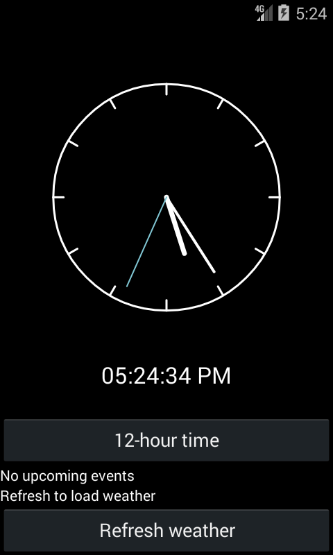

# Legacy feasibility slice

This isolated experiment targets **API 14** and **API 19** with one minSdk 14
APK. It is not an API14-FULL or API19-CONSERVATIVE product release.
The modern `app` keeps minSdk 21. The two renderers actually share Java 8
`clock-core` hand-angle calculations.

API14 and API19 release screenshots:




The experimental application ID is `com.linzin.linzindeskclock.legacy.spike`.
It does not replace the original app. Release probes use an explicitly local
test signature, not an upstream or production signing identity. Version 1 is
an experimental identity; final signing and upgrade policy remain release work.

## Scope

| Capability | This slice | Full implementation still required |
| --- | --- | --- |
| Clock | Native analog Canvas, animated seconds, wall time | All eight styles, seconds controls and golden fixtures |
| Settings | Persistent 12/24-hour display | Language selector, units, brightness, rotation, timeout, tutorials |
| Layout | One clock with native controls | Single/dual regions, gestures, lock, narrow/font-scale matrix |
| Calendar | Three upcoming entries in seven days, read-only worker, permission/empty/error states | Month view and complete sidebar behavior |
| Weather | Manual HTTPS current temperature from saved valid coordinates, stale/error labeling | Live location, geocoding integration, four forecasts, complete persistence |
| Other | Foreground animation and cleanup | Battery, update UI, capability notices and full lifecycle matrix |
| Quality | API14/19 emulator, R8/v1, network trust boundary probes | Old ARM hardware budgets, upgrades, soak and final release gates |

RuntimeShader and fold/cutout capabilities are not provided by this slice.
Do not treat a missing general feature as an accepted platform downgrade.

## Build and test

Use the repository's configured JDK and Android SDK. Build and unit tests must
run separately on Windows:

```powershell
.\gradlew.bat :clock-core:test :app-legacy:testDebugUnitTest :app:testDebugUnitTest
.\gradlew.bat :app-legacy:assembleDebug :app-legacy:assembleDebugAndroidTest :legacy-test-fixture:assembleDebug :app-legacy:assembleRelease :app-legacy:lintDebug
```

Sign `app-legacy/build/outputs/apk/release/app-legacy-release-unsigned.apk` with
your local test key using `apksigner sign`, then run
`apksigner verify --min-sdk-version 14 --verbose --print-certs`.
Use the same test certificate as the debug instrumentation APK.
Do not check a keystore or its passwords into Git.

```powershell
.\scripts\Test-Legacy.ps1 -Serial 127.0.0.1:5561 -Apk C:\absolute\legacy-signed.apk
.\scripts\Test-Legacy.ps1 -Serial emulator-5562 -Apk C:\absolute\legacy-signed.apk
```

The runner checks the real API number and APK hashes, then exercises clock,
process restart, an owned CalendarProvider fixture, real Open-Meteo JSON, and
TLS positive/negative controls. It fails on unavailable live services and
cleans up its own calendar in `finally`. It resets **this experimental app's**
preferences. Use isolated AVDs. Every ADB command includes the supplied serial.

The `legacy-test-fixture` APK is test-only, has no launcher, and is the only
module with calendar write permission. It records its own calendar ID and
checks ownership before deletion. The product requests only READ_CALENDAR.
API14 has no CancellationSignal query API: late cursors are closed and discarded;
an in-flight CalendarProvider Binder operation cannot be forcibly interrupted.

For debug-only internal boundary probes, use the same native instrumentation
with `-e mode calendarChecks` or `-e mode socketChecks`. The latter connects to
a silent loopback TLS peer and checks deadline/cancellation socket closure.
These modes reference unminified implementation classes; the external matrix
above also works against R8 release builds.
`certificateChecks` decodes the 118 bundled root keys and validates a frozen,
normally verified public Open-Meteo chain at its capture date. It also works
on release because BC registration classes are retained. This broad key audit
is slow on the API14 ARM emulator and is a diagnostic, not a per-change gate.

## TLS and frozen inputs

BC 1.87 `jdk15to18` supplies crypto, PKIX and TLS through explicit provider
objects. No global provider replacement, JNI, AndroidX or Play Services is used
in Legacy. TLS 1.2 is enforced against old HttpConnection/OkHttp SSLv3 rewrites.
BC HTTPS endpoint identification validates the hostname during the handshake;
the platform's default verifier is retained as an additional check.
Untrusted and wrong-host peers must fail before any HTTP response. Redirects
are rejected and there is no HTTP fallback. Responses are capped at 64 KiB.
Each request has a 30-second transport watchdog; cancellation closes the raw
layered socket without waiting for the TLS/URLConnection monitor.

`dependency-checksums.sha256` pins the three jars and certificate-only BKS asset.
`verifyLegacyInputs` runs before builds, including release. Maven Central's
official `repo1.maven.org` endpoint is used only for the BC group.
R8 retains BC's dynamic registrations. Optional BC LDAP/JNDI stores are unused
and unavailable on Android; the JNDI missing-class suppression is scoped to
`javax.naming`. Local PKIX uses the bundled root store, not LDAP discovery.

The trust bundle comes from curl/Mozilla NSS, dated 2026-11-05, with 118 roots.
Source and hashes are in `src/main/assets/third_party/Mozilla-CA-NOTICE.txt`;
BC and MPL-2.0 notices ship in the APK. The empty public BKS password protects
no secret; APK signing protects the bundled bytes. `/dev/urandom` is the explicit
entropy source, and an unavailable source fails closed.

Root updates require a reviewed app update: obtain the official Mozilla bundle
from `https://curl.se/ca/cacert.pem` over verified HTTPS, review certificate and
license changes, and run `tools/legacy/FreezeRoots.java` on the host with the
pinned BC provider jar (`FreezeRoots input.pem output.bks`). Record the new
source date/hash, BKS hash and certificate count; update the notice and checksum
file together. Re-run API14/19 release positive and negative controls. Never
add a failing server's leaf certificate to make a connection pass.
Builds use the checked-in frozen BKS; they never download or regenerate roots.

## Environment and limits

API14 was Android 4.0.2, official default ARM v7a image r2, with the archived
official Emulator 26.1.4 classic engine. Modern QEMU2 rejects that ARM image.
API19 was Android 4.4.2, official default x86 image r6, on Emulator 36.1.9/WHPX.
Keep the classic engine in a separate directory; do not replace the current SDK
emulator. An API15 image is not an API14 test substitute.

Emulators establish OS compatibility for exercised paths. They do not establish
old ARM performance, battery life, frame budgets, full feature parity or final
signing/upgrade/soak acceptance. Those remain separate gates.
